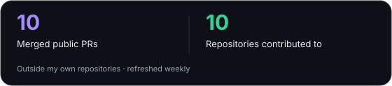
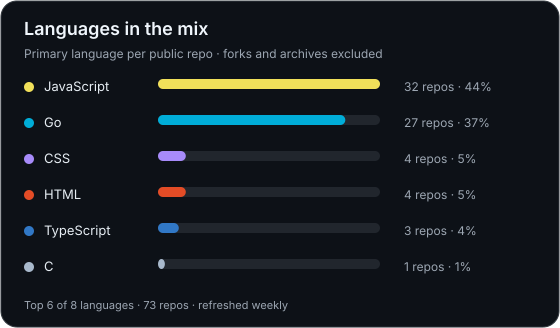

# Hey, I'm Yemi 👋

I build software for commerce, payments, and Bitcoin — from the services behind a product to the interfaces people use.

  

### These days

- 🛠️ Building commerce, ticketing, and media systems at **[Clooza](https://clooza.com)**.
- ⚡ Bringing Bitcoin payments to web and chat as founder of **[Ipilẹ Wallet](https://ipile.xyz)**.
- 🌱 Mentoring engineers learning Bitcoin and Rust through **[Btrust Builders](https://www.btrust.tech/)**.

Beyond code: Christian, drawn to Stoic philosophy, and always learning.

